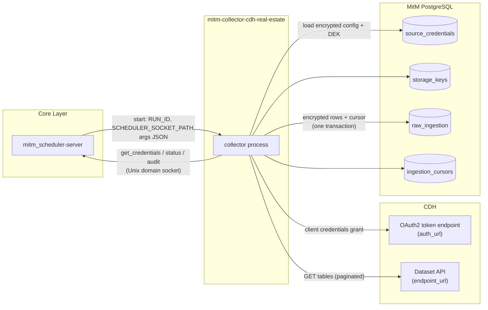
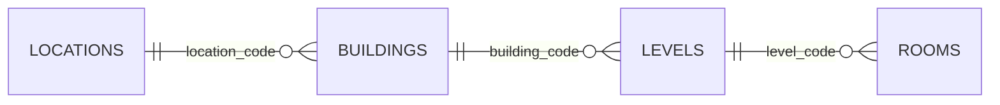
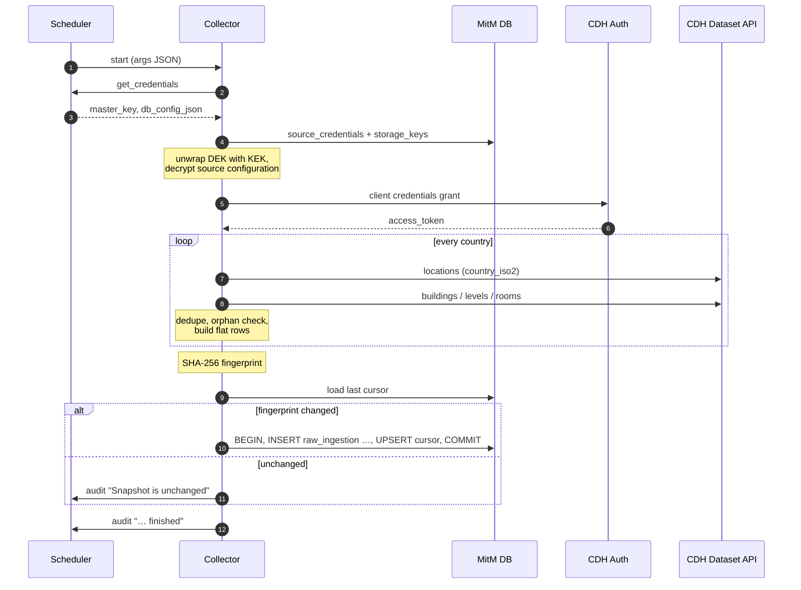

# CDH Real Estate Collector


`mitm-collector-cdh-real-estate` is a standalone Go collector of the
**Man-in-the-Middle (MitM) Data Aggregator**. It reads the CDH real-estate
hierarchy – **locations › buildings › levels › rooms** – per country from the
CDH dataset API, flattens it into **one row per entity**, encrypts every row
with AES-GCM (envelope encryption) and stores it in the central `raw_ingestion`
landing zone.

It is the Go port of the Python script `cdh_real-estate_country_flat.py` and
follows the collector contract described in
[`collector_concept.md`](../collector_concept.md) and
[`collector_creation_guide.md`](../collector_creation_guide.md).

---

## Table of Contents

- [Features](#features)
- [Architecture](#architecture)
- [Data Model](#data-model)
- [How It Works](#how-it-works)
- [Requirements](#requirements)
- [Build, Test and Install](#build-test-and-install)
- [Configuration](#configuration)
  - [1. Encrypted Source Configuration](#1-encrypted-source-configuration)
  - [2. Job Arguments](#2-job-arguments)
  - [3. Scheduler Job Registration](#3-scheduler-job-registration)
  - [4. Standalone Runtime Environment](#4-standalone-runtime-environment)
- [Cursor and Idempotency](#cursor-and-idempotency)
- [Error Handling and Retries](#error-handling-and-retries)
- [Scheduler Events](#scheduler-events)
- [Security](#security)
- [Troubleshooting](#troubleshooting)
- [Differences to the Python Script](#differences-to-the-python-script)
- [Project Layout](#project-layout)
- [License](#license)

---

## Features

- **Complete hierarchy per country** – locations filtered by `country_iso2`,
  buildings, levels and rooms resolved through their parent codes.
- **All columns** – no column list is sent to the API, so new source columns
  arrive without a code change.
- **One flat row per entity** – left join of the four levels with prefixed
  columns (`loc_`, `bld_`, `lvl_`, `room_`) and a `row_level` marker.
- **Two fetch strategies** – one request per parent key (default) or one bulk
  request per child table with local filtering (`bulk_children`).
- **Resilient API access** – `next_token` pagination, retries with exponential
  backoff, automatic token refresh on HTTP 401/403.
- **Snapshot cursor** – SHA-256 fingerprint of the complete result; unchanged
  snapshots are not written again.
- **Atomic ingestion** – all records and the cursor are committed in one
  PostgreSQL transaction.
- **Envelope encryption** – every row is encrypted with the source's DEK and a
  fresh 12-byte nonce; credentials are stored encrypted in `source_credentials`.
- **Scheduler integration** – credentials via IPC, status and audit events over
  the scheduler's Unix domain socket, exit code `1` on every fatal error.

---

## Architecture



---

## Data Model

The CDH real-estate dataset consists of four tables that form a strict
hierarchy (see `data/v2_ERD.md`):



| Level | Default table | Primary key | Join key to parent | Flat prefix |
|---|---|---|---|---|
| Location | `v2_locations` | `location_code` | – | `loc_` |
| Building | `v2_buildings` | `building_code` | `location_code` | `bld_` |
| Level | `v2_levels` | `level_code` | `building_code` | `lvl_` |
| Room | `v2_rooms` | `room_code` | `level_code` | `room_` |

### Flat Row

The four tables are left-joined. Every entity produces exactly one flat row:

| Source situation | Resulting flat row | `row_level` | Business key |
|---|---|---|---|
| Room | location + building + level + room | `room` | `room_code` |
| Level without rooms | location + building + level | `level` | `level_code` |
| Building without levels | location + building | `building` | `building_code` |
| Location without buildings | location only | `location` | `location_code` |

Column rules:

| Column | Content |
|---|---|
| `row_level` | Deepest level present in the row. |
| `location_code`, `building_code`, `level_code`, `room_code` | Join keys, never prefixed; `null` where the level is missing. |
| `loc_*`, `bld_*`, `lvl_*`, `room_*` | All other columns of the respective table. |
| `loc_data_source`, `loc_ingest_date` | Kept on location level only; `data_source` and `ingest_date` of buildings, levels and rooms are dropped. |

Every flat row contains **every** column of the snapshot; missing values are
`null`. Numbers are kept exactly as delivered by the API.

Example of one decrypted `raw_ingestion.payload` (shortened, values are
illustrative):

```json
{
  "row_level": "room",
  "location_code": "14.43",
  "building_code": "14.43/010.0",
  "level_code": "14.43/010.0 01.0",
  "room_code": "14.43/010.0 01.0 012",
  "loc_name": "Plant Example",
  "loc_country_iso2": "AT",
  "loc_city": "Example City",
  "loc_latitude": 48.2082,
  "loc_longitude": 16.3738,
  "loc_status_code": "BEST",
  "loc_data_source": "SAP",
  "loc_ingest_date": "2026-11-10",
  "bld_name_en": "Office Building",
  "bld_asset_class_code": "BUR",
  "bld_gross_floor_area": 5120.5,
  "lvl_name_en": "1st floor",
  "lvl_level_short_code": "01",
  "lvl_net_area": 812.0,
  "room_room_name": "Meeting room",
  "room_room_net_area": 24.75,
  "room_level_short_code": "01"
}
```

The record's `correlation_id` is `UUIDv5(6ba7b810-9dad-11d1-80b4-00c04fd430c8, <business key>)`,
so the same room always gets the same correlation ID – across runs and
collectors.

---

## How It Works



1. **Bootstrap** – requests the Master Key (KEK) and the MitM database
   configuration from the scheduler over IPC; falls back to environment
   variables for standalone runs. Parses and validates the job arguments.
2. **Decrypt credentials** – loads `source_credentials` for `source_name`,
   unwraps the referenced DEK from `storage_keys` with the KEK and decrypts
   the CDH configuration.
3. **Authenticate** – OAuth2 client-credentials grant against `auth_url`.
4. **Collect per country**
   1. `locations` with filter `{"country_iso2": "<country>"}`.
   2. `buildings` per `location_code`, `levels` per `building_code`, `rooms`
      per `level_code` – or, with `bulk_children`, each child table once,
      filtered locally to the collected parent codes.
   3. Drop rows without primary key and duplicate primary keys (first wins);
      report orphaned child rows.
   4. Left-join into flat rows.
5. **Fingerprint** – SHA-256 over all flat rows of all countries,
   independent of the order the API returns them in.
6. **Ingest** – if the fingerprint differs from the stored cursor, every flat
   row is encrypted and inserted into `raw_ingestion` (`status = 'pending'`),
   in batches of 1000, followed by the cursor upsert – all in **one**
   transaction.

Every table request sends `table`, `hub`, `region`, `stage`, `dataset_id`,
`filter` (JSON) and `limit`, and follows `next_token` until it is empty or
`max_pages` is reached.

---

## Requirements

- Go **1.27** (only for building)
- Network access to the CDH token endpoint and the CDH dataset API
- A MitM PostgreSQL database with the tables `source_credentials`,
  `storage_keys`, `raw_ingestion` and `ingestion_cursors`
- An active `source_credentials` entry for the configured `source_name`
- A running `mitm_scheduler-server` (or the standalone environment variables
  below)

---

## Build, Test and Install

```sh
# run the unit tests
go test ./...

# static release build; the version comes from the Git tag
./build.sh
```

`build.sh` builds `bin/mitm-collector-cdh-real-estate` with
`-X main.version=$(git describe --tags)` and copies it to `../../app/bin/`,
next to the scheduler binary. The scheduler resolves a job's `command`
relative to its own directory.

Manual build:

```sh
CGO_ENABLED=0 go build -ldflags="-s -w -X main.version=v0.1.0" \
  -o ./bin/mitm-collector-cdh-real-estate main.go
```

Releases are tagged `vMAJOR.MINOR.PATCH`; see [`CHANGELOG.md`](CHANGELOG.md).

---

## Configuration

The collector is configured in three places:

| Where | What | Who reads it |
|---|---|---|
| `source_credentials.config_payload` (encrypted) | CDH credentials and endpoints | Collector, after decryption with the DEK |
| `scheduled_programs.args` (JSON) | Dataset, tables, countries, options | Scheduler passes it as `os.Args[1]` |
| Environment / IPC | MitM database and Master Key | Scheduler IPC, or environment for standalone runs |

### 1. Encrypted Source Configuration

Decrypted content of `source_credentials.config_payload`:

```json
{
  "client_id": "<client-id>",
  "client_secret": "<client-secret>",
  "auth_url": "https://<sso-host>/auth/oauth2/realms/root/realms/alpha/access_token",
  "endpoint_url": "https://<dataset-api-host>/v1/data/table/glue-sync",
  "hub": "global",
  "region": "eu-west-1",
  "stage": "prod",
  "page_size": 1000,
  "timeout_seconds": 60
}
```

| Field | Required | Default | Description |
|---|:---:|---|---|
| `client_id` | ✅ | – | OAuth2 machine-to-machine client ID. Also builds the scope `machine2machine client_<client_id>`. |
| `client_secret` | ✅ | – | OAuth2 machine-to-machine client secret. |
| `auth_url` | ✅ | – | OAuth2 token endpoint (client-credentials grant, form-encoded). |
| `endpoint_url` | ✅ | – | CDH dataset API table endpoint (`getDatasetData`). |
| `hub` | ✅ | – | `hub` query parameter, e.g. `global`. |
| `region` | ✅ | – | `region` query parameter, e.g. `eu-west-1`. |
| `stage` | ✅ | – | `stage` query parameter: `dev`, `int` or `prod`. |
| `page_size` | | `1000` | Rows per request (`limit`), 1–1000. |
| `timeout_seconds` | | `60` | Timeout of every HTTP request. |

The configuration is stored encrypted through the MitM HTTP server, which
encrypts `config_payload` with the active DEK. Example with `curl` (an admin
session token is required; `config_payload` is the JSON above **as a string**):

```sh
curl -sS -X POST "https://<mitm-host>:8443/api/v1/config/credentials" \
  -H "Authorization: Bearer <session-token>" \
  -H "Content-Type: application/json" \
  -d '{
        "source_name": "CDH_REAL_ESTATE",
        "connector_type": "REST_API",
        "topic": "cdh.real_estate.data",
        "is_active": true,
        "config_payload": "{\"client_id\":\"<client-id>\",\"client_secret\":\"<client-secret>\",\"auth_url\":\"https://<sso-host>/auth/oauth2/realms/root/realms/alpha/access_token\",\"endpoint_url\":\"https://<dataset-api-host>/v1/data/table/glue-sync\",\"hub\":\"global\",\"region\":\"eu-west-1\",\"stage\":\"prod\"}"
      }'
```

The same can be done in the admin frontends (source credentials view). Use one
`source_credentials` entry per stage, e.g. `CDH_REAL_ESTATE_PROD` and
`CDH_REAL_ESTATE_INT`.

### 2. Job Arguments

The scheduler passes `scheduled_programs.args` verbatim as the first
command-line argument.

```json
{
  "source_name": "CDH_REAL_ESTATE",
  "topic": "cdh.real_estate.data",
  "dataset_id": "facility_places_re_base_sem",
  "tables": {
    "locations": "v2_locations",
    "buildings": "v2_buildings",
    "levels": "v2_levels",
    "rooms": "v2_rooms"
  },
  "countries": ["AT", "DE"],
  "bulk_children": false,
  "max_pages": 0,
  "insecure_skip_verify": false
}
```

| Field | Required | Default | Description |
|---|:---:|---|---|
| `source_name` | ✅ | – | Active `source_credentials` entry; also `raw_ingestion.source_system` and the cursor key. |
| `dataset_id` | ✅ | – | CDH dataset identifier (`dataset_id` query parameter). |
| `tables.locations` | ✅ | – | Table name of the location level. |
| `tables.buildings` | ✅ | – | Table name of the building level. |
| `tables.levels` | ✅ | – | Table name of the level (floor) level. |
| `tables.rooms` | ✅ | – | Table name of the room level. |
| `countries` | ✅ | – | ISO-3166 alpha-2 country codes; case-insensitive, at least one. |
| `topic` | | `cdh.real_estate.data` | Routing topic of every `raw_ingestion` record. |
| `bulk_children` | | `false` | `true`: read every child table once and filter locally. |
| `max_pages` | | `0` (unlimited) | Page limit **per request**; intended for tests only. |
| `insecure_skip_verify` | | `false` | `true` disables TLS certificate verification (logged as audit warning). |

Table names must match `^[a-zA-Z0-9_]+$`. All flat rows of all countries form
**one** snapshot and share **one** cursor per `source_name`.

#### Example: single country, default strategy

```json
{
  "source_name": "CDH_REAL_ESTATE",
  "dataset_id": "facility_places_re_base_sem",
  "tables": { "locations": "v2_locations", "buildings": "v2_buildings", "levels": "v2_levels", "rooms": "v2_rooms" },
  "countries": ["AT"]
}
```

#### Example: many countries with bulk child tables

With many locations, one request per parent key means thousands of requests
(one per level for the rooms). `bulk_children` reads each child table once
instead – fewer requests, more data transferred:

```json
{
  "source_name": "CDH_REAL_ESTATE_EU",
  "topic": "cdh.real_estate.eu.data",
  "dataset_id": "facility_places_re_base_sem",
  "tables": { "locations": "v2_locations", "buildings": "v2_buildings", "levels": "v2_levels", "rooms": "v2_rooms" },
  "countries": ["AT", "DE", "FR", "IT", "ES", "NL"],
  "bulk_children": true
}
```

#### Example: quick test run against the integration stage

```json
{
  "source_name": "CDH_REAL_ESTATE_INT",
  "topic": "cdh.real_estate.test",
  "dataset_id": "facility_places_re_base_sem",
  "tables": { "locations": "v2_locations", "buildings": "v2_buildings", "levels": "v2_levels", "rooms": "v2_rooms" },
  "countries": ["AT"],
  "max_pages": 1
}
```

> [!WARNING]
> `max_pages` truncates the result. Do not use it with a production
> `source_name`: the truncated snapshot becomes the stored cursor.

#### Example: environment with a TLS-intercepting proxy

```json
{
  "source_name": "CDH_REAL_ESTATE",
  "dataset_id": "facility_places_re_base_sem",
  "tables": { "locations": "v2_locations", "buildings": "v2_buildings", "levels": "v2_levels", "rooms": "v2_rooms" },
  "countries": ["AT"],
  "insecure_skip_verify": true
}
```

> [!CAUTION]
> `insecure_skip_verify` exposes the client secret and the access token to
> man-in-the-middle attacks. Prefer installing the proxy's CA certificate in
> the system trust store.

### 3. Scheduler Job Registration

Daily run at 03:00:

```sql
INSERT INTO scheduled_programs (name, command, args, cron_expr, enabled, restart_on_exit)
VALUES (
  'cdh_real_estate',
  'mitm-collector-cdh-real-estate',
  '{
     "source_name": "CDH_REAL_ESTATE",
     "dataset_id": "facility_places_re_base_sem",
     "tables": {"locations": "v2_locations", "buildings": "v2_buildings",
                "levels": "v2_levels", "rooms": "v2_rooms"},
     "countries": ["AT", "DE"]
   }'::jsonb,
  '0 3 * * *',
  true,
  false
);
```

Weekly run (Sunday 02:30) for a larger region with bulk child tables:

```sql
INSERT INTO scheduled_programs (name, command, args, cron_expr, enabled, restart_on_exit)
VALUES (
  'cdh_real_estate_eu',
  'mitm-collector-cdh-real-estate',
  '{
     "source_name": "CDH_REAL_ESTATE_EU",
     "topic": "cdh.real_estate.eu.data",
     "dataset_id": "facility_places_re_base_sem",
     "tables": {"locations": "v2_locations", "buildings": "v2_buildings",
                "levels": "v2_levels", "rooms": "v2_rooms"},
     "countries": ["AT", "DE", "FR", "IT", "ES", "NL"],
     "bulk_children": true
   }'::jsonb,
  '30 2 * * 0',
  true,
  false
);
```

Notes:

- `cron_expr` uses 5 fields; the scheduler adds seconds/year.
- The same job never runs twice in parallel.
- `restart_on_exit = false` is recommended: a failed run is repeated by the
  next schedule, and the cursor prevents duplicate records.
- Jobs can also be started manually via the HTTP server
  (`POST /api/v1/jobs/<name>/execute`).

### 4. Standalone Runtime Environment

Under the scheduler (`RUN_ID` and `SCHEDULER_SOCKET_PATH` set) everything is
delivered over IPC. For local diagnostics set:

| Variable | Description |
|---|---|
| `MASTER_KEY` | KEK: Base64-encoded 32 bytes or 32 raw bytes. Must match the key used to wrap the DEKs. |
| `MITM_DB_CONFIG_JSON` | Preferred. JSON with a nested `db` object (`host`, `port`, `user`, `password`, `database`, boolean `sslmode`). |
| `MITM_DB_HOST`, `MITM_DB_PORT`, `MITM_DB_USER`, `MITM_DB_PASSWORD`, `MITM_DB_NAME` | Individual parameters, used when `MITM_DB_CONFIG_JSON` is not set. |
| `MITM_DB_SSLMODE` | `true` → `require`, `false` → `disable`; other values (e.g. `verify-full`) are passed through. Default: `disable`. |

With `MITM_DB_CONFIG_JSON`:

```sh
export MASTER_KEY='<base64-encoded-32-byte-kek>'
export MITM_DB_CONFIG_JSON='{"db":{"host":"localhost","port":5432,"user":"mitm","password":"<password>","database":"mitm","sslmode":false}}'

./bin/mitm-collector-cdh-real-estate '{
  "source_name": "CDH_REAL_ESTATE_INT",
  "dataset_id": "facility_places_re_base_sem",
  "tables": {"locations": "v2_locations", "buildings": "v2_buildings", "levels": "v2_levels", "rooms": "v2_rooms"},
  "countries": ["AT"],
  "max_pages": 1
}'
```

With individual variables:

```sh
export MASTER_KEY='<base64-encoded-32-byte-kek>'
export MITM_DB_HOST=localhost MITM_DB_PORT=5432 MITM_DB_NAME=mitm
export MITM_DB_USER=mitm MITM_DB_PASSWORD='<password>' MITM_DB_SSLMODE=verify-full

./bin/mitm-collector-cdh-real-estate "$(cat job-args.json)"
```

Exit code `0` means success, `1` a fatal error (message on stderr).

---

## Cursor and Idempotency

The CDH API has no incremental offset. The collector therefore stores the
**SHA-256 fingerprint** of the complete snapshot in
`ingestion_cursors.last_cursor` (key: `source_name`):

- Rows are serialized to JSON (sorted keys), the lines are sorted, then hashed –
  the fingerprint does not depend on the order the API returns rows in.
- **Unchanged** fingerprint → nothing is written
  (`Snapshot is unchanged (<n> flat rows); no record ingested`).
- **Changed** fingerprint → the **complete** snapshot is written, one record per
  flat row, together with the new cursor in one transaction. If anything fails,
  nothing is committed and the old cursor stays.

Because the `correlation_id` is deterministic, the Transformation Layer can
identify the newest version of every entity.

> [!NOTE]
> Every value of a row is part of the fingerprint. If the source updates
> `ingest_date` on every load, every run writes a new snapshot.

To force a complete re-ingestion, delete the cursor:

```sql
DELETE FROM ingestion_cursors WHERE source_name = 'CDH_REAL_ESTATE';
```

---

## Error Handling and Retries

| Situation | Behavior |
|---|---|
| HTTP 5xx, HTTP 429, timeout, connection error | Up to **4 attempts**, waiting 5 s, 10 s and 20 s in between. |
| HTTP 401 / 403 | Token is refreshed **once**, the request is repeated. |
| Still failing after retries / refresh | Request is **skipped**; `WARNING: skipped request <table> <filter>: <reason>` is written to `job_audit_logs`. The run continues. |
| Any other HTTP 4xx (e.g. 400, 404) | Fatal. |
| Invalid response, token request failure | Fatal. |
| Invalid job arguments or source configuration | Fatal. |
| Database or decryption error | Fatal. |
| `SIGTERM` (stop request / scheduler shutdown) | Context is cancelled; an open transaction is rolled back. |

A fatal error sends a `failed` status event and the audit event
`ERROR: <message>`, then exits with code `1`; the scheduler records the
exit code in `program_runs` and `system_logs`.

> [!IMPORTANT]
> Skipped requests make the snapshot **incomplete**. The run still succeeds,
> and the incomplete snapshot is stored. The number of skipped requests is
> reported at the end of the run
> (`WARNING: <n> requests were skipped, data is incomplete`).

---

## Scheduler Events

Status events (`job_status_events`):

| Status | Progress | Message |
|---|---:|---|
| `started` | 0 | `CDH Real Estate Collector (<version>) started` |
| `processing` | 20 | `Connected to MitM database` |
| `processing` | 50 | `Authenticated at CDH API` |
| `processing` | 70 | `Encrypting and ingesting flat rows` |
| `failed` | 0 | Error message |

Audit events (`job_audit_logs`, component `mitm_collector_cdh_real_estate`),
prefixed with `<topic>: <source_name>: ` once both are known:

| Message | Meaning |
|---|---|
| `Loaded database configuration from …` | Source of the MitM DB configuration |
| `Decrypted CDH connection credentials payload successfully` | Source configuration decrypted |
| `WARNING: TLS certificate verification is disabled (insecure_skip_verify)` | `insecure_skip_verify` is active |
| `<country>: <n> locations, <n> buildings, <n> levels, <n> rooms` | Result per country |
| `WARNING: <table>: dropped <n> rows without <pk>` | Rows without primary key |
| `WARNING: <table>: dropped <n> duplicate <pk> values` | Duplicate primary keys |
| `WARNING: <table>: <n> rows without parent in <parent table>` | Orphaned child rows |
| `WARNING: skipped request <table> <filter>: <reason>` | Request skipped after retries |
| `WARNING: <n> requests were skipped, data is incomplete` | Summary of skipped requests |
| `Snapshot is unchanged (<n> flat rows); no record ingested` | Fingerprint unchanged |
| `Ingested <n> flat rows. Cursor updated to <sha256>.` | Snapshot written |
| `ERROR: <message>` | Fatal error |
| `CDH Real Estate Collector (<version>) finished` | Successful end of the run |

---

## Security

- The Master Key (KEK) exists only in memory; under the scheduler it is
  delivered over IPC and never read from the process environment.
- CDH credentials are stored AES-GCM encrypted in `source_credentials` and
  decrypted in memory only.
- Every flat row is encrypted with the source's DEK and a fresh random 12-byte
  nonce before it reaches the database.
- Client secret, access token, Master Key, decrypted payloads and the decrypted
  source configuration are never written to logs or scheduler events. Error
  messages contain table names, filters and HTTP status codes only.
- TLS certificate verification is enabled unless `insecure_skip_verify` is set
  explicitly.
- Table names are validated against `^[a-zA-Z0-9_]+$`, country codes against
  `^[A-Z]{2}$`.

---

## Troubleshooting

| Audit / error message | Cause and fix |
|---|---|
| `dataset_id is required in the collector arguments` | `args` of the job is incomplete – see [Job Arguments](#2-job-arguments). |
| `tables.rooms is missing or has an invalid format` | Table name missing or contains invalid characters. |
| `Failed to load source credentials for '<name>': no rows in result set` | No active `source_credentials` entry with this `source_name`. |
| `Failed to decrypt wrapped DEK (KEK mismatch or corrupted key data)` | `MASTER_KEY` differs from the key used to wrap the DEK. |
| `source configuration is missing <field>` | Decrypted configuration is incomplete – see [Source Configuration](#1-encrypted-source-configuration). |
| `CDH access-token request returned HTTP 401` | Wrong `client_id` / `client_secret` or `auth_url`. |
| `request CDH access token: … x509: certificate signed by unknown authority` | TLS-intercepting proxy; install its CA certificate (or, as a last resort, `insecure_skip_verify`). |
| `CDH request for table <t> returned HTTP 400` | Wrong `hub`, `region`, `stage`, `dataset_id` or table name. |
| `WARNING: skipped request … still HTTP 403 after token refresh` | The client has no access to this table or filter. |
| Many `WARNING: skipped request … HTTP 429` | Rate limit; use `bulk_children` to reduce the number of requests. |

---

## Differences to the Python Script

| `cdh_real-estate_country_flat.py` | This collector |
|---|---|
| Writes `<country>_real_estate_flat.csv` (and optionally single-table CSVs / XLSX) | Writes one encrypted `raw_ingestion` record per flat row |
| Credentials from `cdh_real-estate.py` / environment | Credentials and endpoints from the encrypted `source_credentials` |
| Dataset, hub, region, stage as CLI options | Dataset, tables and countries as job arguments; hub, region, stage in the source configuration |
| Fixed ERD column lists | All columns delivered by the API |
| TLS verification **off** by default (`--insecure`) | TLS verification **on**; `insecure_skip_verify` to disable |
| `--drop-empty`, `--also-tables`, `--xlsx`, `--output-dir` | Not ported (not applicable to the RAW landing zone) |
| Other key columns of a child table produce pandas `_x` / `_y` duplicates | Such columns are prefixed |
| Output on every run | Only when the snapshot fingerprint changes |

---

## Project Layout

```text
mitm_collector_cdh_real_estate/
├── main.go          # collector: IPC, configuration, CDH client, flattening, ingestion
├── main_test.go     # unit tests (arguments, configuration, API client, flattening, fingerprint)
├── go.mod / go.sum
├── build.sh         # release build, copies the binary to ../../app/bin/
├── CHANGELOG.md
├── NOTICE
├── LICENSE
└── data/            # Python reference scripts and ERD (not versioned)
```

---

## License

Licensed under the [Apache License 2.0](LICENSE).
Copyright (c) 2026 ZHENG Robert.
